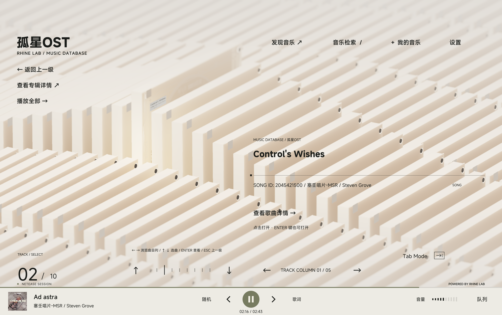

# StreamSound 桌面端

Qt 6.12 + C++ 实现的桌面客户端。界面与 3D 场景基于 [Rhine Music Database](https://github.com/MikeQu223/Rhine-Music-Database)（MIT），数据层已替换为 StreamSound 自建 HTTP 服务；在线音乐平台桥接已全部移除。



## 特性

- 账号密码登录（服务器 `POST /auth/login`），令牌由桥接进程持有并在过期时自动刷新
- 四栏目：搜索曲目、喜欢的歌曲、文件夹、播放历史
- HTTP Range 串流、播放队列、进度与音量同步、LRC 歌词、封面主色
- 音频与封面经 `127.0.0.1` 本地代理注入 Bearer，播放器不接触令牌

## 目录

```text
desktop/
├── Qt/src/          C++：HUD、RHI 场景、曲库模型、播放器、桥接管理
├── Qt/qml/          QML：登录输入层
├── MusicBridge/     Node 桥接：streamsound.cjs、本地媒体代理
├── Assets/          字体、模型、着色与预览图
├── Resources/       场景槽位与启动字标
└── scripts/         资源导出、打包、安装器
```

## 构建与运行（Windows）

```powershell
cmake -S desktop -B desktop/build -G "Visual Studio 18 2026" -A x64 `
  -DCMAKE_PREFIX_PATH="<Qt 6.12 msvc2022_64>" -DRHINE_ENABLE_FIDELITYFX=OFF
cmake --build desktop/build --config Release
```

构建后部署 Qt 运行库与资源：

```powershell
cd desktop
python scripts/export-assets.py
python scripts/bake-archive-lighting.py
<Qt>\bin\windeployqt.exe --release --qmldir Qt\qml build\Release\RhineMusicDatabase.exe
Copy-Item output\resources build\Release\resources -Recurse -Force
```

运行：

```powershell
desktop\build\Release\RhineMusicDatabase.exe
```

- 服务器地址：偏好项 `streamsound-server`，默认 `http://127.0.0.1:8080`
- 开发期若 `MusicBridge/node.exe` 不存在，会回退到系统 `node`
- 完整发布包：`node scripts/build.cjs`（见 [部署文档](../docs/technical/deployment.md)）

详细设计见 [桌面端方案](../docs/plan/desktop-client.md) 与 [系统架构](../docs/technical/architecture.md)。

## 许可

MIT，见 [LICENSE](LICENSE)；第三方组件与上游声明见 [NOTICE](NOTICE)。
